# Tempo


**A personal companion for your wearable data.**

Tempo is an independent, open-source iPhone app for collecting, understanding and keeping your own wearable measurements. It brings daily context, workouts, sleep records, journalling and transparent personal analytics into a native, local-first experience. The current interoperability work targets personally owned WHOOP 4.0 and WHOOP 5.0 hardware.

Tempo uses Swift, SwiftUI, direct Bluetooth, local SQLite storage, on-device analytics, optional Apple Health integration and private iCloud synchronization. Support for multiple registered bands is one feature within that broader experience; your personal history remains the centre of the product.

> **Current status: buildable engineering implementation, not a complete or physically validated daily-use release.** Simulator and unsigned iPhone builds pass. Live Bluetooth behavior, signed HealthKit operation, and two-phone CloudKit restore have not been validated on physical devices. Historical retrieval is experimental for read-confirmed WHOOP4 41.17.6.0 and WHOOP5 50.42.1.0 with a positive stored-range result; successful recovery on owned bands and several requested features remain unverified or unfinished. See [acceptance status and remaining work](docs/KnownLimitations.md) before relying on collection.

## Project purpose and personal builds

Tempo explores direct interoperability with supported wearable hardware and gives owners a transparent way to retain and inspect available measurements. It is a separate application with its own interface, storage model and analytics, rather than an implementation of the manufacturer's service or proprietary scores.

You can clone or fork this public repository and build your own installation under the [MIT licence](LICENSE). Configure your own Apple signing identifiers, App Group and private CloudKit container; your installation should not use another contributor's provisioning or health dataset. No shared Tempo service or account is operated by this repository.

Manufacturer names identify hardware compatibility only. Tempo is not an official WHOOP application and does not claim equivalent features, measurements or validation. Compatibility remains bounded by device generation, firmware and the evidence documented below.

## What is implemented

| Area | Current implementation | Verification boundary |
|---|---|---|
| Native interface | Redesigned Today with native large title, live-reading hero, compact readiness, paired sleep/movement summaries, pull/manual refresh and quiet sync status; four-hour Live history, reported battery beside the source band, freshness/coverage/source evidence, band/placement sheet, cross-tab workout controls, finish summary, journal and sleep editors | Simulator interactions tested; full accessibility audit pending |
| Bluetooth | Discovery, generation correction, disconnect/remove with history retained, bounded connection retries, foreground silent-stream recovery, receipt/storage diagnostics, standard Heart Rate Service notifications, Core Bluetooth restoration configuration | Neither physical band tested |
| Protocol | Separate Whoop 4/5 framing, checksums, bounded fragment assembly, HR/RR parsing, firmware-gated Whoop4/Whoop5 history transfer with durable raw frames/checkpoints and ordinary receipt acknowledgements; Whoop5 range preflight | Constructed fixtures; physical transfer/replay unverified; unsupported layouts retained raw |
| Wearing placement | Per-band wrist, upper-arm/bicep and underwear reports with effective times, corrections and session context | User-reported; no automatic location detection or unverified sensor correction |
| Multiple bands | Portable device identities, separate phone peripheral mappings, preferences/temporary override, hysteresis selector, sequential fallback | One connection maintained; unconnected-band wear cannot be observed |
| Local persistence | SQLite WAL/FULL transactions, immutable observations, revision ancestry, tombstones, checkpoints and durable sync outbox | Integrity/replay/rollback tests pass |
| Automatic activity | Opt-in sustained-HR candidates, review/type/timing edits, confirmation and dismissal | Experimental HR-only rules; physical accuracy unverified |
| Workouts | Padel, cycling, running, strength, walking and other; start/pause/resume/finish; persisted state, source segments, HR chart, zones, load, notes and exertion | Domain and simulator tests pass; physical continuity pending |
| Sleep and journal | Entered/imported sleep, naps flag, timezone retention, manual corrections; optional energy, mood, soreness and behaviours | Experimental HR-only possible-sleep proposals with user review; motion-backed detection and staging unavailable |
| Analytics | Quality-gated RMSSD/SDNN, conservative personal readiness, Edwards cardiovascular load, source-change confidence reduction | Transparent rules tested; no medical or proprietary-algorithm validation |
| Trends | Period overview with typical recorded day, recorded-day coverage, local-day covered-time HR averages, per-metric medians/latest weight, missing-day gaps and inspectable evidence over 7/28/90 days | Full metric catalogue, custom ranges and personal-insight pairing unfinished |
| Private sync | Foreground freshness checks, separate last-success/pending status, compressed bounded batches, incremental zone tokens, durable retries, immutable edit conflicts, logical deletions and account binding | Adapter compiles; signed two-phone integration pending |
| Apple Health | Optional selected imports and measured HR/manual sleep/recorded workout exports; provenance and own-source exclusion | Physical permission, reconciliation and export behavior pending |
| Backup | Versioned JSON archive, manifest fields, SHA-256 validation and transactional idempotent restore | Core tests pass; large streaming archives unfinished |
| Extensions | Summary widget and workout Live Activity, stale timestamps and widget privacy option | Targets compile; physical Lock Screen behavior pending |
| Demo | Labelled synthetic data in a separate in-memory database, with real integrations disabled | UI tests and normal-store synthetic rejection tested |

On Today, the live dashboard sits directly below readiness, with an accessible Refresh control and pull-to-refresh. Last reading and last successful iCloud sync remain separate; refresh does not imply historical backfill. Sleep timing is a compact tappable summary; its detail supports correction and adding another session.

Connection and wearing are separate: nearby advertisements are not connected bands, contact reports are not inferred from proximity, and automatic mode retains a usable selected source even if both bands are worn. See [band controls, live dashboard and automatic refresh](docs/BandManagement.md) for thresholds and physical retest steps.

The app does not fabricate unsupported sensor values. Battery, calibrated temperature, respiration, SpO₂, proprietary wear detection, band haptics and firmware alarms remain unavailable or hidden until supported implementation and physical validation exist.

To inspect band history support, tap the top-right Settings gear → **Band status and history**, then scroll to **History retrieval**. Application firmware and the actual transfer/refusal status appear there for registered bands. On Today, tapping the band-name row beneath live heart rate opens the same view.

Rendering diagnostics such as the reported QuartzCore handler message are documented in [RenderingDiagnostics.md](docs/RenderingDiagnostics.md), including a reproduction independent of Tempo’s Bluetooth and cloud code.

## Requirements

- An iPhone running **iOS 26 or later** for physical installation.
- Xcode 26 or newer with an appropriate iOS SDK and Swift 6 toolchain.
- Your Apple developer account and provisioning that supports CloudKit, HealthKit and App Groups for the full configured app. A free personal team is not equivalent to those entitlements.
- Owned Whoop bands for Bluetooth validation. The current live path requires the standard Heart Rate Service to be exposed, including supported pairing/broadcast settings where necessary.
- The same Apple account on participating iPhones for private iCloud restoration.
- Python 3 only if regenerating the Xcode project or geometric app icon.

There are no third-party package downloads. `TempoCore` is a local Swift package; SQLite is provided by the operating system. Its macOS build exists for core tests, not as a macOS product.

The recorded development environment was Apple Silicon, Xcode 27.0 (27A266a), and the iOS 27 simulator SDK/runtime. Deployment remains iOS 26; no iOS 27-specific APIs were assumed. **An iOS 26 runtime has not been tested here.**

## Open and run in Xcode

```sh
git clone https://github.com/abhiyoheswaran1/tempo.git
cd tempo
open Tempo.xcworkspace
```

**Open `Tempo.xcworkspace` (recommended) or `Tempo.xcodeproj`, not the repository folder or `Package.swift`.** The Swift package provides the `TempoCore` library and tests; it has no runnable iPhone executable. The native **Tempo** scheme builds `Tempo.app`. Select **Tempo** in Xcode's toolbar, then an iPhone running iOS26+ or an iPhone simulator. You can also double-click [Scripts/Open-Tempo.command](Scripts/Open-Tempo.command).

If the toolbar or navigator says **TempoCore**, close that package window and reopen the app workspace. If Run → Info shows no executable, check the selected scheme is **Tempo**; its shared scheme selects `Tempo.app`. A red `Tempo.app` product before the first successful build is normal; binaries are generated by Xcode, not committed to this source repository.

1. Open **Xcode → Settings → Accounts** and add your Apple developer account.
2. Edit [Configuration.xcconfig](Configuration.xcconfig) using identifiers you own:

   ```xcconfig
   TEMPO_BUNDLE_ID = your.unique.tempo.identifier
   TEMPO_APP_GROUP = group.your.unique.tempo.identifier
   TEMPO_CLOUD_CONTAINER = iCloud.your.unique.tempo.identifier
   DEVELOPMENT_TEAM = YOUR_TEAM_ID
   ```

3. In Signing & Capabilities, keep automatic signing enabled for **Tempo** and **TempoWidgets**. The widget identifier is the app identifier with `.widgets` appended.
4. Register the App Group and CloudKit container. Tempo needs **iCloud/CloudKit, HealthKit and App Groups**; TempoWidgets needs the same App Group. Check that the provisioning profiles contain the configured capabilities.
5. Select the **Tempo** scheme and an installed iPhone simulator to explore the interface, or your connected iPhone for real collection. Enable Developer Mode and trust the developer profile on the phone if prompted.
6. Build and Run. Provision CloudKit before enabling sync. Do not commit passwords, signing certificates, provisioning profiles or personal health exports.

The checked-in identifiers are examples and `DEVELOPMENT_TEAM` is intentionally blank. An unsigned device build does not prove signing, installation, Bluetooth permissions or cloud capabilities.

See [complete installation instructions](docs/Setup.md) and [CloudKit setup](docs/CloudKit.md).

## First physical-band test

1. Leave demo mode off. Open **Settings → Manage and reconnect bands**.
2. Choose the generation and scan while your owned band is in its supported pairing/broadcast state. Explicitly identify the physical band; a generic name, proximity or RSSI does not prove identity or wear.
3. Register the first band, then the second. On a restored installation select **Reconnect [existing band]** rather than creating a new portable identity.
4. Test each band separately: confirm that actual heart-rate notifications arrive, timestamps advance and measurements persist after relaunch. RR intervals are used only when present in the packet.
5. Record a short workout, pause/resume it, finish, relaunch and inspect coverage/source segments. Repeat offline and through a brief Bluetooth interruption.
6. Export a backup and follow the [physical validation checklist](docs/HardwareValidation.md). Record generation, firmware, iOS version and results.

Only one band connection is maintained by default. Automatic selection software has hysteresis and interruption grace, but does not establish reliable automatic wear detection on an unconnected band. Historical catch-up is experimental on the supported application firmwares; unknown firmware, refused requests, invalid band time or missing stored records can leave gaps. iOS background restoration is supported configuration, not a guarantee of continuous execution after force-quit or system termination.

## Simulator demo

Enable **Settings → Simulator demo**, or add `--demo` to the scheme's launch arguments. A visible banner identifies every demonstration as synthetic. Demo mode uses a separate in-memory store and suspends real collection; CloudKit, Health exports and normal backup export are disabled. Turning it off reopens the real local dataset.

UI tests additionally use `--ui-testing` for an isolated in-memory dataset. Add `--activity-detection-demo` alongside both arguments to exercise a clearly synthetic potential-workout review. These arguments never establish physical Bluetooth support.

## Screenshots

These are real screenshots captured from Tempo running in the iOS simulator, with synthetic demonstration data or an isolated empty test dataset. They are not mockups or physical-iPhone captures and do not validate band connectivity. Tap an image to open it at full resolution.

| Today | Activity | Trends |
|---|---|---|
| [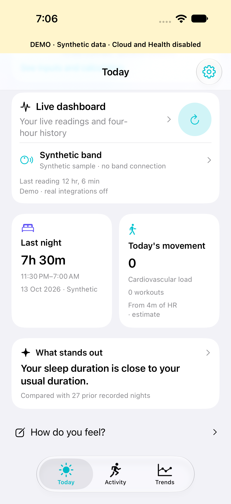](docs/screenshots/today-demo.png) | [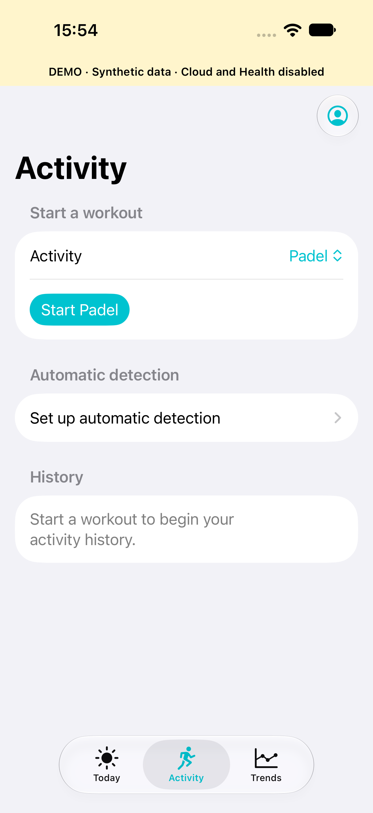](docs/screenshots/activity-demo.png) | [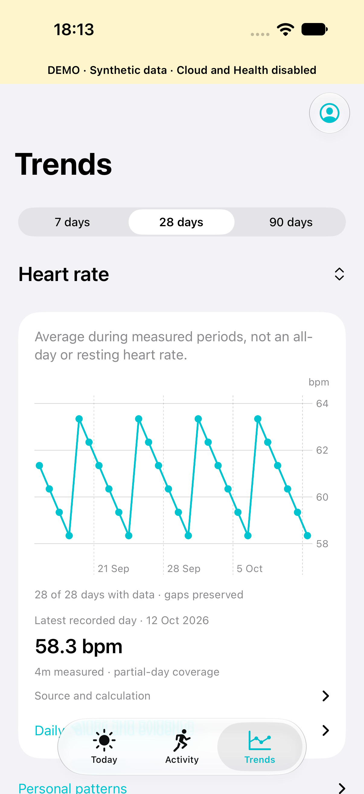](docs/screenshots/trends-demo.png) |

| Workout | Readiness explanation | Settings |
|---|---|---|
| [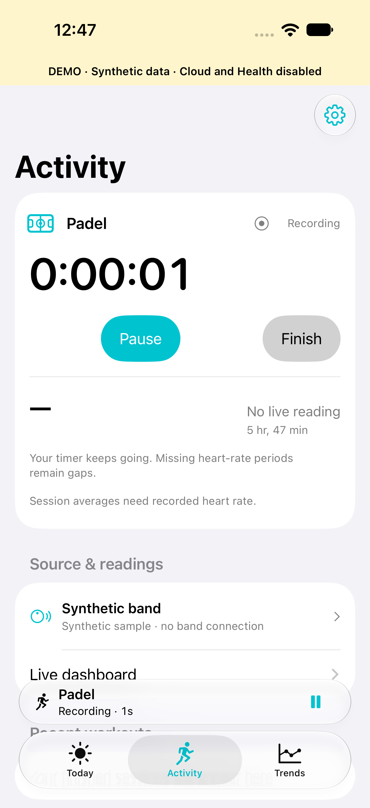](docs/screenshots/workout-demo.png) | [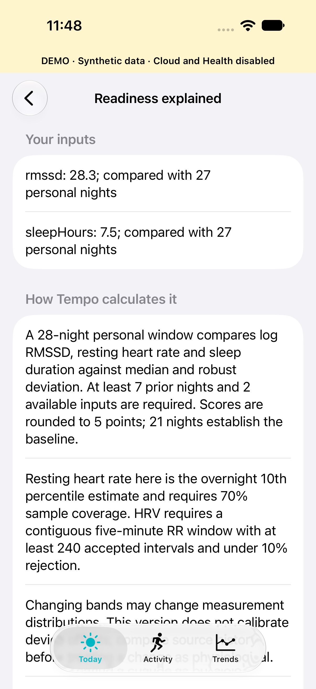](docs/screenshots/readiness-demo.png) | [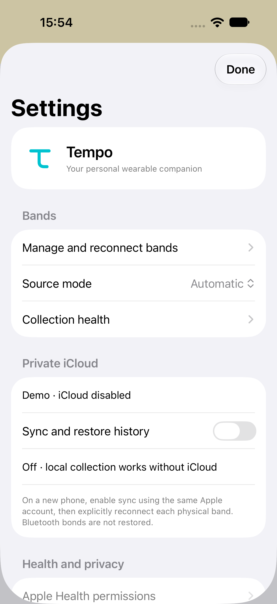](docs/screenshots/settings-demo.png) |

| Workout summary | Activity review | Dark mode · maximum text |
|---|---|---|
| [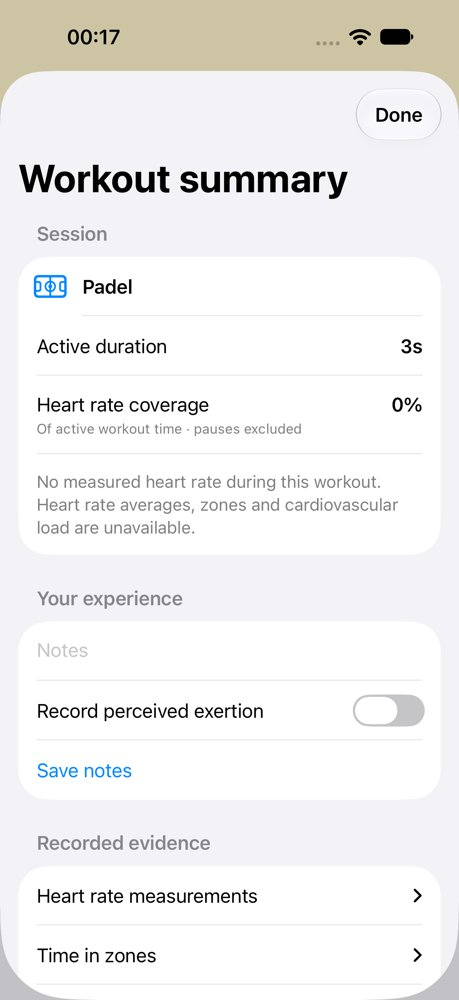](docs/screenshots/workout-summary-demo.png) | [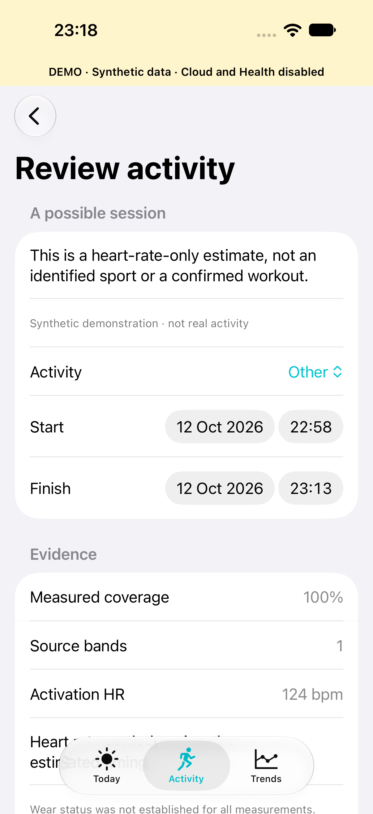](docs/screenshots/detected-activity-demo.png) | [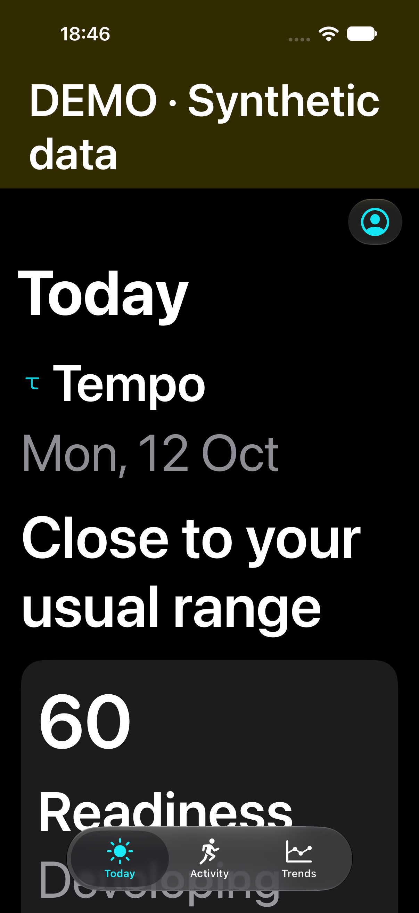](docs/screenshots/today-dark-large-text-demo.png) |

[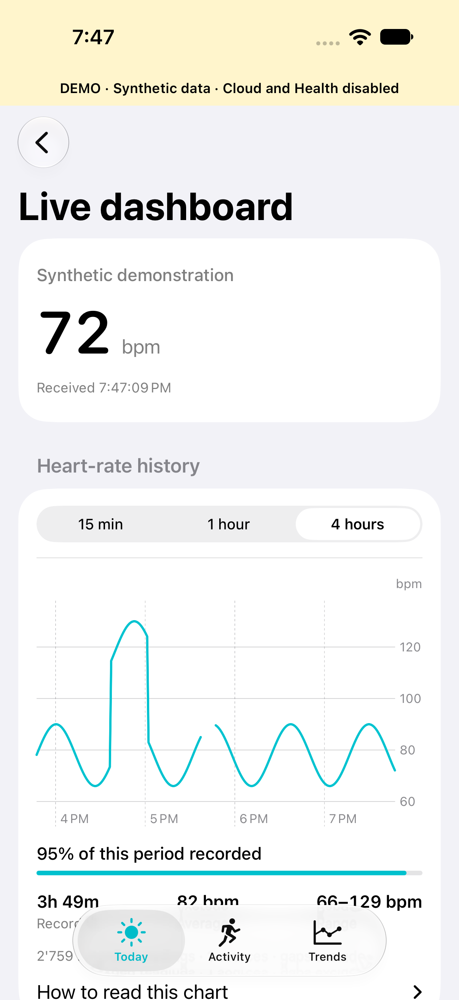](docs/screenshots/live-dashboard-demo.png)

All twenty-one captures come from successful simulator tests. Today now uses a native large title, a prominent live-reading entry, compact readiness and paired sleep/movement summaries. Tap the date on Today to explore a past day. What stands out offers an inspectable sleep-duration comparison after seven prior recorded nights. The paired sleep/movement cards have equal content-driven heights; at accessibility text sizes they stack vertically. Tapping movement opens daily load, coverage and zone evidence directly. Collection comes first while a baseline builds; unavailable readiness has compact progress instead of an empty score. Activity puts sport selection and Start first, with focused recording controls and a cancelable Finish alert. Trends puts the typical recorded day and recorded-day coverage above one focused chart. Select a point or an accessible daily row to inspect evidence; missing days stay empty. Same-dataset refreshes retain the chart and selected day. Sleep remains a separate session view. Live puts the current/recent reading and a larger four-hour chart first, with 15-minute and one-hour options. Coverage shows the percentage of the selected period recorded; blank periods remain visible. Chart methodology and source evidence expand on demand. Pull-to-refresh requests band collection and enabled cloud sync. Pull down or tap Refresh on Today to check collection and request enabled cloud sync. Journal puts Energy, Soreness and Mood first, with optional context and same-day editing. Workout details put notes/exertion ahead of collapsible measurement evidence. Capture provenance and checksums are in [the screenshot manifest](docs/screenshots/capture-manifest.json). Sleep detail now leads with duration and recorded-zone timing, followed by a separate heart-rate receipt chart and coverage; correction and provenance remain accessible.

| Baseline building · empty test dataset | Band status · empty test dataset | Sleep trends · synthetic demo |
|---|---|---|
| [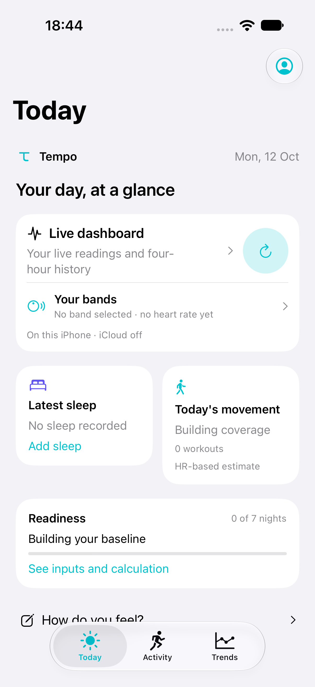](docs/screenshots/today-baseline-empty.png) | [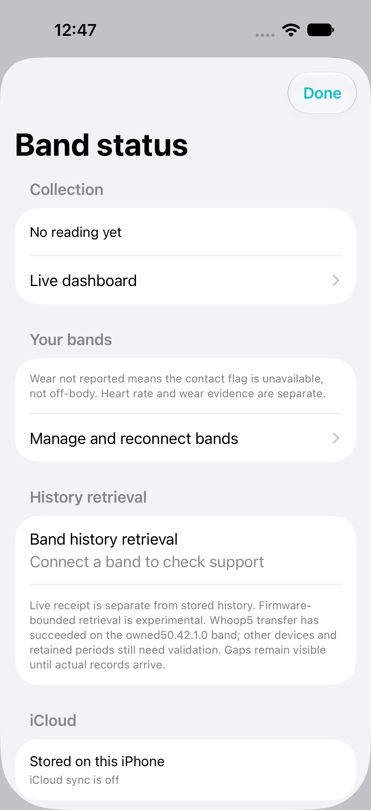](docs/screenshots/band-status-empty.png) | [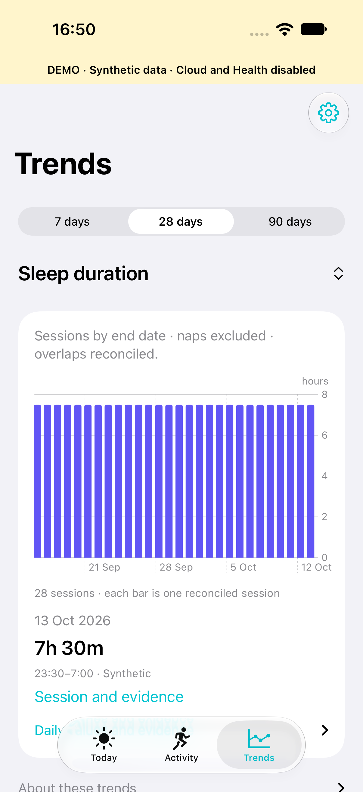](docs/screenshots/sleep-trends-demo.png) |


[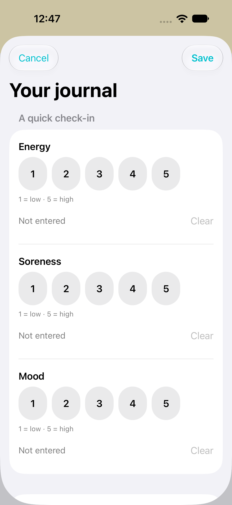](docs/screenshots/journal-demo.png)

## Logo and Xcode assets

The original Tempo mark is a rounded T with a curved stem, in teal and deep ink. The same mark appears inside the app and widget and is already configured as the Home Screen icon.

[](Branding/tempo-app-icon-1024.png)

Download the [logo kit ZIP](Branding/Tempo-Logo-Kit.zip), or use the [Branding folder](Branding/README.md). It contains editable SVGs, a transparent PNG logo, an opaque 1024-pixel icon, and ready-to-import `AppIcon.appiconset` and `TempoMark.imageset` folders. In this project, the assets are already installed: build and run through Xcode to put the icon on your phone. For another project, drag those folders into its asset catalog and select `AppIcon` as the App Icons Source.

## CloudKit and another iPhone

Sync is optional and defaults off. Local collection, workouts, journal entries and existing history do not depend on network availability.

Provision the configured private container, then enable sync in Settings. The adapter uses an account-namespaced custom zone and record type `TempoPayload`:

| Field | Type |
|---|---|
| `kind` | String |
| `schemaVersion` | Int64 |
| `payload` | Encrypted Bytes, written through `CKRecord.encryptedValues` |
| `checksum` | String |

Sensor uploads use 15-minute UTC buckets instead of a CloudKit record per high-frequency sample. Observations have stable IDs; edits are immutable revisions with parent ancestry. Concurrent edits remain available for resolution. Downloads advance their token after page commits, and failed uploads remain queued with backoff. Account binding prevents automatic transfer of an existing dataset into a different Apple account.

On another signed iPhone using the same configuration and Apple account, enable sync, verify restored records, and explicitly reconnect the physical bands. **CloudKit does not restore Bluetooth bonds or phone peripheral identifiers.** Actual two-phone restore, quota failure and account-change behavior require physical validation. Sync currently runs on activation/manual action; background push scheduling is unfinished.

Follow the [schema, encryption and restore instructions](docs/CloudKit.md).

## Optional Apple Health

Choose individual import/export types in Tempo's Health settings before requesting permissions. Denying permissions must not prevent local band collection or manual entries.

- Imports include selected HR, resting HR, SDNN, sleep, workouts and weight.
- Exports include supported measured HR, manually entered sleep as asleep-unspecified, and manual or explicitly confirmed estimated workouts, with provenance. Padel uses Health's Other activity with Tempo metadata rather than being mislabeled as another sport.
- Tempo excludes its own source from imports and preserves external sample UUID provenance.
- **RMSSD is never written into HealthKit's SDNN field.**

Imports are bounded to 1,000 records per type per action; repeat to continue. HR exports are bounded to 500 samples per action. Deleting app history does not automatically delete its Health exports. Source reconciliation and actual permission/export behavior require further physical testing; see [limitations](docs/KnownLimitations.md).

## Analytics and missing data

Tempo's readiness model is its own transparent estimate, not Whoop's proprietary recovery score. It needs qualifying personal history and sufficient available inputs; otherwise it displays an unavailable/building-baseline state.

- RR preprocessing rejects implausible intervals and artefacts; RMSSD needs valid beat-to-beat data, not a low-frequency HR series.
- Readiness compares available overnight inputs with a personal baseline; 7 prior nights permit provisional calculations and 21 establish the baseline. Missing inputs are omitted rather than filled with zero.
- Band source changes preserve history and lower confidence because device offsets are not calibrated.
- Cardiovascular load uses weighted HR-zone minutes and an editable maximum-HR assumption. Gaps and workout pauses are excluded; HR does not quantify muscular load during strength training.
- Unanswered journal items remain unknown. The association primitive requires sufficient observations; its UI pairing workflow is unfinished.

Every score explanation includes assumptions and an algorithm identifier. See [methodology and exact thresholds](docs/Analytics.md). Outputs are personal training guidance, not diagnoses or clinically validated measurements.

## Privacy, storage and independent backup

There are no advertising, tracking or third-party analytics SDKs. Routine diagnostics exclude health payloads. Apple manages account credentials; Tempo stores no cloud passwords or API keys.

Local files use protection compatible with supported background access after first unlock. Private CloudKit payloads use encrypted fields. **This implementation does not claim end-to-end encryption.** Protection depends on platform behavior and account conditions.

Export/restore is separate from synchronization. A backup includes version/algorithm metadata, immutable observations, provenance, correction ancestry and deletion markers. Restore checks schema and SHA-256 before a transaction, rejects conflicting same-ID values, and is idempotent for repeated imports. Bluetooth bonds and cloud/Health anchors are not portable backup state.

**Exports are plaintext health data.** Checksums detect alteration but do not encrypt or authenticate an archive. Keep backups securely. The v1 archive is built in memory and has a 256 MiB decoded limit; streaming multi-gigabyte backups and local high-frequency compaction remain unfinished. Current JSON observation rows can accumulate substantial storage; raw high-frequency optical/IMU streams are not enabled.

See [storage decisions](docs/Architecture.md) and [backup format](docs/ExportFormat.md).

## Build and test from the command line

Use Xcode's developer directory without changing global `xcode-select` settings:

```sh
export DEVELOPER_DIR=/Applications/Xcode.app/Contents/Developer

# Hardware-independent core tests
/Applications/Xcode.app/Contents/Developer/Toolchains/XcodeDefault.xctoolchain/usr/bin/swift test --scratch-path /tmp/tempo-core-tests

# Unsigned simulator build
xcodebuild -project Tempo.xcodeproj -scheme Tempo -sdk iphonesimulator -destination 'generic/platform=iOS Simulator' -derivedDataPath /tmp/tempo-simulator CODE_SIGNING_ALLOWED=NO build

# List installed simulators, then select one for UI tests
xcrun simctl list devices available
xcodebuild -project Tempo.xcodeproj -scheme Tempo -destination 'platform=iOS Simulator,name=iPhone 18 Pro' -derivedDataPath /tmp/tempo-ui-tests ARCHS=arm64 CODE_SIGNING_ALLOWED=NO test

# Unsigned device compilation, without installation or hardware validation
xcodebuild -project Tempo.xcodeproj -scheme Tempo -sdk iphoneos -destination 'generic/platform=iOS' -derivedDataPath /tmp/tempo-device CODE_SIGNING_ALLOWED=NO build
```

Replace the simulator name with one installed locally. The explicit arm64 UI command is for Apple Silicon. If build caches report stale local-package modules, use a fresh derived-data directory. Do not interpret an unsigned build as a successful signed deployment.

Recorded verification: **122 core tests passed. All19 simulator tests passed, followed by four affected-screen checks and final capture reruns. Fourteen real simulator captures cover synthetic and empty states. Simulator and unsigned iPhone builds pass.** Tests cover parser corruption/truncation/fragmentation, unsupported firmware, duplicate history, atomic checkpoints, overlap selection, source hysteresis, workout persistence, DST duration, RR quality, insufficient baselines, sensor-change confidence, revisions/conflicts/deletions, backup checksums/replay, outbox races/backoff, restored Health provenance, synthetic rejection, bounded reads and gap-aware charts.

The UI suite exercises missing-data tabs, workout actions and the labelled demo/navigation layout. It does not establish VoiceOver quality, physical radio operation, real CloudKit synchronization or HealthKit behavior. See the [verification ledger](docs/Verification.md).

## Source layout

```text
Tempo/                  SwiftUI app, screens and iOS service adapters
Tempo/Resources/        App assets, Info.plist, entitlements, privacy manifest
Sources/TempoCore/      Domain models, parsers, SQLite, reconciliation and analytics
Sources/CSQLite/        System SQLite module bridge
Shared/                 Workout Live Activity attributes
TempoWidgets/           WidgetKit and ActivityKit extension
Tests/TempoCoreTests/   Hardware-independent regression tests
Tests/TempoUITests/     Simulator interaction tests
Scripts/                Deterministic project and vector branding generators
Branding/               Editable logos and Xcode-ready exported assets
docs/                   Architecture, protocols, methodology and validation
Configuration.xcconfig  Personal signing and container identifiers
Tempo.xcodeproj/        Committed Xcode project and shared Tempo scheme
```

The core owns storage through a Swift actor; iOS services own their mutable state explicitly. Protocol parsers do not depend on SwiftUI or Bluetooth hardware. Local edits use transactional parent comparison, and workout mutations are serialized. Dataset transitions suspend collection and reject synthetic inputs in normal stores.

After adding native source/resource files, regenerate the committed project with `python3 Scripts/generate_project.py`. The script preserves your identifier settings in `Configuration.xcconfig`. `python3 Scripts/create_icon.py` rebuilds the original geometric icon.

## Wrist, upper arm and underwear

Tempo records all three placements separately for each band. Open **Settings → Manage and reconnect bands → your band → Record wearing placement** whenever you move it. You can also record an earlier change or correct an existing report. Earlier, ambiguous or unreported periods remain unknown; a location report never establishes that a band was on-body.

Placement context follows measurement timestamps into workout and sleep details and is included in private sync and independent backup. Known placement changes in available overnight samples lower readiness confidence without changing measured values or resetting your history. HR zones and HRV formulas are unchanged; motion-specific steps and muscular-load algorithms remain unavailable. See [evidence, use and limitations](docs/WearingPlacement.md).

## Automatic activity detection

Enable **Settings → Activity → Automatic activity detection** to find potential workouts from sustained, sufficiently covered band heart rate. This experimental feature starts disabled. Review suggestions in Activity, choose the sport and correct timing, then confirm or dismiss. Unconfirmed suggestions do not count toward workout totals or export to Apple Health.

Tempo does not identify padel from heart rate or reproduce WHOOP's automatic classifier. Stress can cause false positives; low-heart-rate walking and strength sessions can be missed. Gaps are preserved, overlapping band samples are reconciled, and decisions survive restore and repeated scans. Confirmed sessions retain their estimated origin and algorithm version. See [rules, thresholds and limitations](docs/AutomaticActivity.md). Physical-band accuracy still needs validation.

## Improvement tracking

[Active improvements](docs/Improvements.md) is the compact work queue: stable IDs, priorities, acceptance checks and explicit hardware gates. Completed tickets leave that queue and get one short entry in [Completed](docs/Completed.md). Lasting behavior stays in the architecture/analytics documents; Git preserves detailed investigation and superseded plans. This avoids repeatedly reading closed tickets without losing evidence or unresolved findings.

## Remaining work

The full requested product is not complete. Major unfinished areas include:

- Safe, firmware-specific historical transfer and interrupted catch-up.
- Dependable physical automatic switching, deeper Whoop 5 inputs, authoritative battery and validated haptic/alarm controls.
- Validated motion-backed sleep detection, naps, richer nightly aggregation, sleep consistency and device-offset calibration. Experimental HR-only possible-sleep review is implemented.
- Full trend catalogue/custom ranges, journal-to-metric insights, route recording, notifications and breathing/haptic sessions.
- Background sync scheduling, fuller Health source/deletion policies, high-volume local compaction and streaming backups.
- Signed two-phone testing, iOS 26 runtime testing and a full accessibility/background reliability audit.

The [acceptance-status document](docs/KnownLimitations.md) distinguishes implementation gaps from physical validation gates. Unsupported measurements remain unavailable instead of being presented as successful features.

## Protocol research, attribution and licence

Tempo's independent protocol research references [Noop](https://github.com/ryanbr/noop) and its credited community interoperability work. No Noop implementation code or documentation prose was copied. Evidence, licence assessment and attribution are recorded in [Protocol research](docs/ProtocolResearch.md).

See [research, evidence boundaries and attribution](docs/ProtocolResearch.md) and the [runtime capability matrix](docs/CapabilityMatrix.md). Future code reuse requires a fresh licence assessment and any required notices. Tempo's own repository licence is [MIT](LICENSE).

Tempo is independent and is not affiliated with or endorsed by WHOOP. Use only hardware you own or are authorized to access. Firmware flashing, destructive commands, service-authentication bypasses and unsupported sensor probing are not implemented.

## Documentation index

- [Build and installation](docs/Setup.md)
- [Architecture](docs/Architecture.md)
- [Protocol research and attribution](docs/ProtocolResearch.md)
- [Capability matrix](docs/CapabilityMatrix.md)
- [Private CloudKit schema and restore](docs/CloudKit.md)
- [Analytics methodology](docs/Analytics.md)
- [Automatic activity rules and validation](docs/AutomaticActivity.md)
- [Wearing placement evidence and behavior](docs/WearingPlacement.md)
- [Independent export format](docs/ExportFormat.md)
- [Physical validation checklist](docs/HardwareValidation.md)
- [Known limitations and acceptance status](docs/KnownLimitations.md)
- [Latest verification](docs/Verification.md)
- [Active improvement tracker](docs/Improvements.md)
- [Compact completion log](docs/Completed.md)
- [Implementation plan and execution ledger](docs/ImplementationPlan.md)

Wear “not reported” means the current heart-rate connection did not supply a supported contact flag; it does not mean off-body. Live heart rate and confirmed wear remain separate evidence. See [band management](docs/BandManagement.md), [rendering diagnostics](docs/RenderingDiagnostics.md) and [App Group diagnostics](docs/AppGroupDiagnostics.md) for the current integration and warning boundaries.

Latest extension checks: five affected simulator flows passed for the four-hour Live chart, range switching, Today refresh and large text; the unsigned iPhone build passes. The central powered-state policy is software-tested; physical Bluetooth startup/restoration retest remains required.

### Possible sleep

Tempo checks recovered heart-rate history automatically for sustained-rest periods. Review the **Possible sleep** card on Today, correct the proposed times, then save or choose **Not sleep**. Proposals are experimental HR-only estimates, not WHOOP sleep records or validated staging. Sparse data and unresolved intervals stay unavailable. Confirmed timing, dismissal and provenance survive revisions and private sync. See [methodology](docs/Analytics.md#experimental-possible-sleep-detector10).

[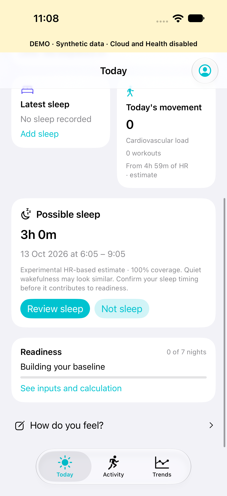](docs/screenshots/possible-sleep-demo.png)

### Overnight collection status

Today distinguishes **Band catch-up stored** from iCloud sync and explains when recorded HR is insufficient for a possible-sleep proposal. An owned WHOOP5/50.42.1.0 has completed a physically observed historical transfer; overnight/background coverage and sleep accuracy remain pending. Large catch-ups reconnect before command-sequence exhaustion and coalesce sleep analysis after incoming chunks settle. Existing nights already offloaded elsewhere may be absent from the band’s returned range. See [history and retention](docs/HistoryRetrieval.md).

### Battery and Settings

Settings has a separate gear button. Today displays the reported band battery percentage beside the source band; stale reports are labelled separately. Missing battery reports remain unavailable.

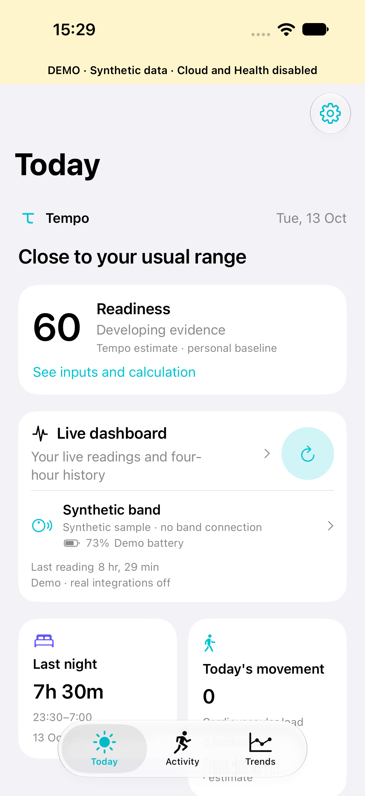

The latest integrity bug pass and its remaining acceptance gates are recorded in [Bug audit](docs/BugAudit.md) and [Verification](docs/Verification.md). Fixes cover query limits/deletions, cloud retry races, timestamp validation and workout chronology; physical overnight recovery and CPU reliability remain open.

### Sleep detail

[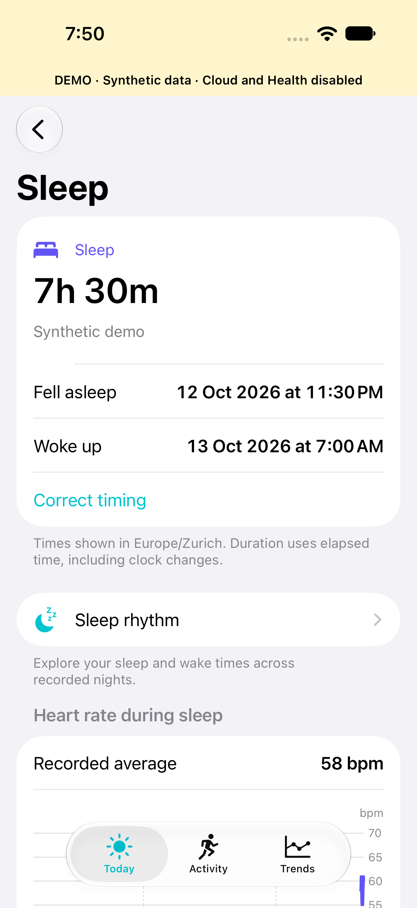](docs/screenshots/sleep-detail-demo.png)

Actual simulator capture with synthetic data. The chart shows recorded periods and leaves gaps visible; it is separate from recovery inputs.

### Daily movement evidence

[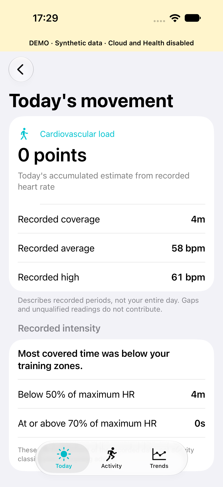](docs/screenshots/movement-detail-demo.png)

The page explains daily cardiovascular load and recorded intensity independently of manual workouts.

### Your history, with context

| Your days | Sleep rhythm | What stands out |
|---|---|---|
| [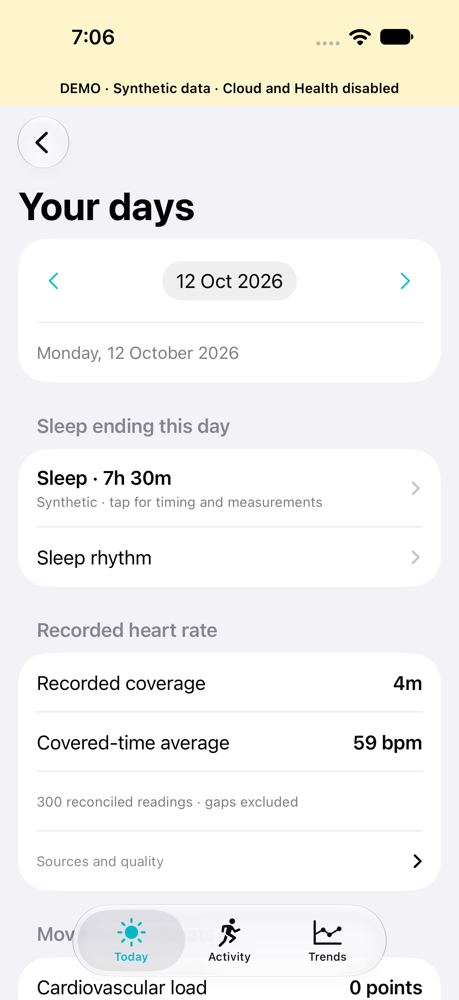](docs/screenshots/day-explorer-demo.png) | [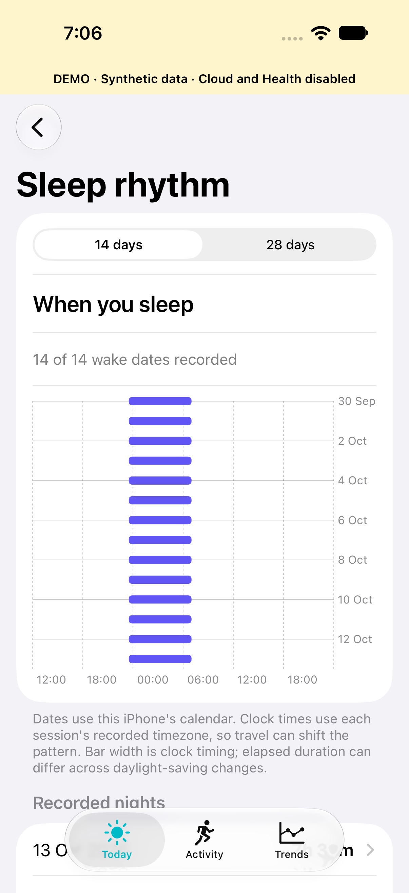](docs/screenshots/sleep-rhythm-demo.png) | [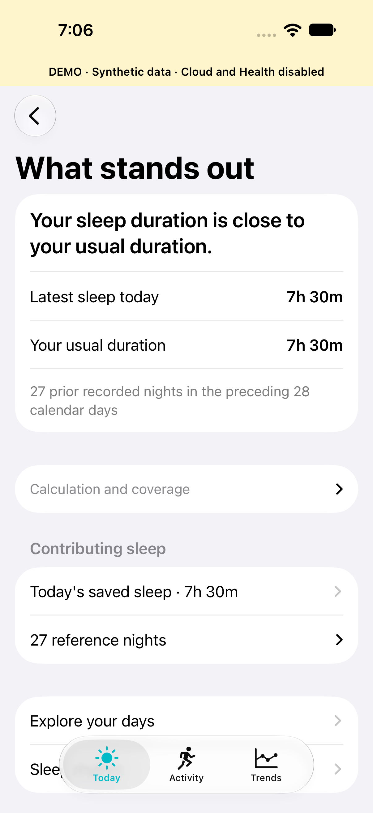](docs/screenshots/observation-detail-demo.png) |

These are unmodified simulator captures with clearly labelled isolated synthetic data. [Day-history methodology](docs/DayHistory.md) documents calendar boundaries, reference coverage, provenance, missing-data behaviour and the bug pass.
